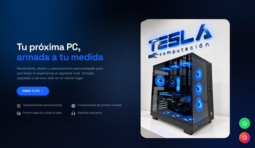
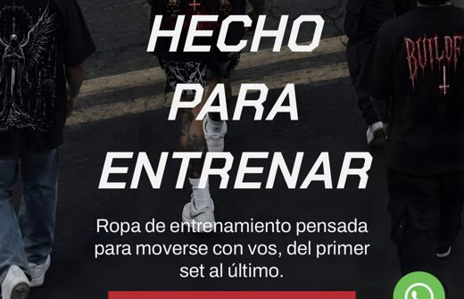
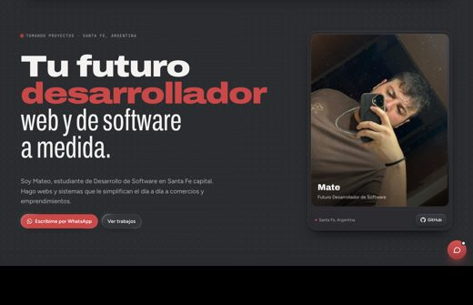

<picture>
  <source media="(prefers-color-scheme: dark)" srcset="assets/logo-oscuro.svg">
  
</picture>

Soy Mate, tengo 21 años y estudio Desarrollo de Software en Santa Fe capital. Hago páginas web: landings y sitios con front y back.

[matedev.com.ar](https://matedev.com.ar) · Santa Fe, Argentina

## Trabajos

| | |
|---|---|
|  | **[Tesla Computación](https://tesla-computacion.vercel.app/)** Un local de Santa Fe quería que el cliente se arme la PC solo. Son 10 pasos, descuenta del stock real y el dueño lo maneja desde su panel.  `Next.js` `PostgreSQL` · [código](https://github.com/mateoacksbenitez-wq/tesla-computacion) |
|  | **[BuildFit](https://buildfitar.mitiendanube.com/)** Una tienda en Tienda Nube con el diseño reescrito a mano en CSS.  `Tienda Nube` `CSS` |
|  | **[mate.dev](https://matedev.com.ar)** Mi web. Fondo animado, carpetas y un formulario que te deja el mensaje listo en WhatsApp.  `HTML` `CSS` `JavaScript` `GSAP` `WebGL` · [código](https://github.com/mateoacksbenitez-wq/mate.dev) |

## Con qué trabajo

- **Front:** HTML, CSS, JavaScript, React, Next.js
- **Back:** Node.js, PostgreSQL
- **Otros:** Git, GitHub Pages, Vercel, Tienda Nube

## Estudios

Desarrollo de Software, Santa Fe (cursando).

## Contacto

Escribime desde [matedev.com.ar](https://matedev.com.ar/#contacto), el formulario te abre WhatsApp con el mensaje armado.
